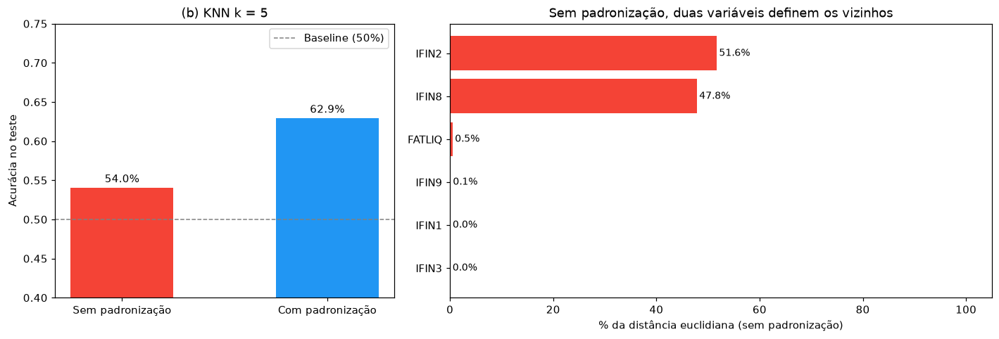
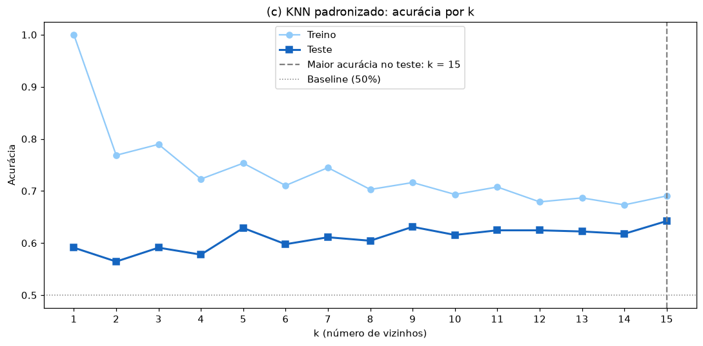
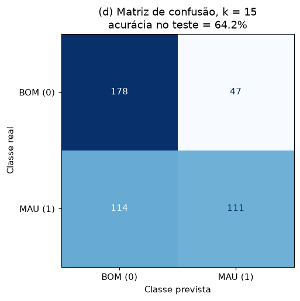
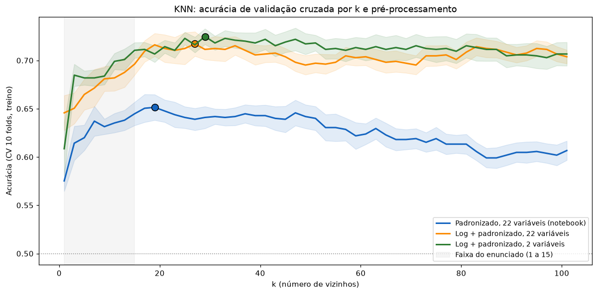
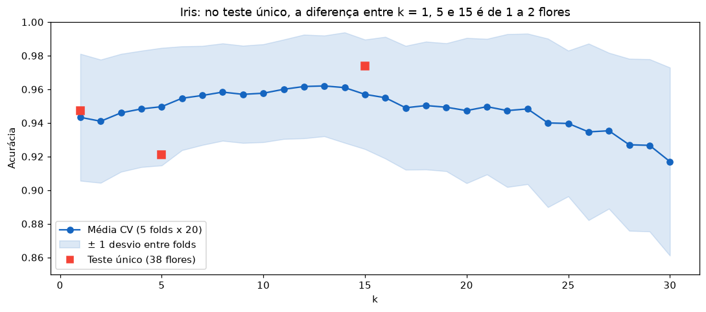
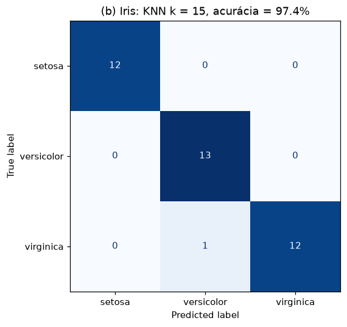

# K-Vizinhos Mais Próximos (KNN): Inadimplência de Empresas e Iris

Classificação com KNN em duas bases. A principal é a base PEJOTA de inadimplência de 1.500 empresas, a mesma dos projetos de árvores de decisão e regressão logística, o que permite comparar os três métodos nos mesmos dados. A segunda é a base Iris, com três espécies de flores.

## Principais resultados

- **Padronizar é indispensável para o KNN.** Sem padronização, duas variáveis (`IFIN2` e `IFIN8`) respondem por 99% da distância entre empresas, e a acurácia fica em 54%, quase o acaso. Padronizando, sobe para 63%.
- **Mesmo padronizado, o KNN fica ~9 pontos atrás da árvore e da logística** (64,2% contra 72% a 76% no teste). As caudas muito longas dos indicadores financeiros fazem com que poucas empresas extremas definam as distâncias.
- **Com um logaritmo antes da padronização, o KNN alcança os outros métodos:** 71,7% de acurácia em validação cruzada, contra 65,1%. Mantendo só as duas variáveis mais relevantes, chega a 72,6%, a maior acurácia de CV entre todos os modelos das três listas. Em AUC, a logística com log continua à frente.
- **Na Iris, k = 1, 5 e 15 são equivalentes.** No teste de 38 flores, a diferença entre eles é de 1 a 2 flores, e a validação cruzada repetida confirma que todos ficam entre 94% e 96%.

## Estrutura do projeto

```
knn-classificacao/
├── data/
│   └── base_pejota.xls           
├── src/
│   ├── config.py                  # caminhos, semente, faixas de k
│   ├── data.py                    # leitura, limpeza e divisão treino/teste
│   ├── preprocessing.py           # pipelines: imputação, escala, log, seleção, modelos
│   ├── q11_pejota.py              # Questão 11, itens (a) a (f)
│   ├── q11_complementos.py        # k por validação cruzada, log, seleção de variáveis
│   ├── q12_iris.py                # Questão 12 (Iris) e validação cruzada repetida
│   └── utils.py                   # salvar tabelas e figuras
├── tests/
│   └── test_knn.py                # pré-processamento e propriedades do KNN
├── results/
│   ├── figures/                   # gráficos usados neste README
│   └── tables/                    # tabelas em CSV
├── main.py
├── requirements.txt
└── README.md
```

A base Iris não tem arquivo em `data/`: ela vem embutida no scikit-learn (`sklearn.datasets.load_iris`) e é carregada direto pelo código.

O `preprocessing.py` concentra a montagem dos modelos. A função `make_knn` recebe a escala (`nenhuma`, `padronizada` ou `log`) e, opcionalmente, quantas variáveis manter. Tudo fica dentro de um `Pipeline`, então a mediana da imputação, a média e o desvio da padronização e a seleção de variáveis são aprendidos só com o treino. Na validação cruzada, só com os folds de treino. Isso importa especialmente na seleção de variáveis: se ela fosse feita com a base inteira, a validação cruzada ficaria otimista.

O mesmo arquivo também monta a árvore e a logística, com as mesmas configurações dos projetos anteriores. A divisão treino/teste também é a mesma (70/30, estratificada, semente 42), então a comparação do item (f) é feita exatamente nos mesmos dados.

---

## Questão 11: KNN na base PEJOTA

### (a) Pré-processamento

A base tem 1.500 empresas, 50% inadimplentes. Células em branco nos `IFIN` viram ausentes, e existem ausentes em `IFIN1` (99), `IFIN2` (98), `IFIN4` (30), `IFIN5` (102), `IFIN7` (40), `IFIN8` (122) e `IDADE` (3). A imputação usa a mediana do treino. `UF` é codificada em três colunas (SP, RJ, MG), e `COD_CLI` fica fora dos preditores. Ficam 22 variáveis, com treino de 1.050 e teste de 450.

### (b) Com e sem padronização (k = 5)

| | Acurácia no teste |
|---|---|
| Sem padronização | 54,0% |
| Com padronização | 62,9% |



O KNN classifica cada empresa pela maioria entre as k empresas mais próximas, medindo a proximidade pela distância euclidiana, que soma as diferenças ao quadrado de todas as variáveis. Sem padronização, uma variável que varia na casa das dezenas de milhares pesa milhões de vezes mais que uma que varia entre 0 e 5.

Dá para medir isso. A contribuição média de cada variável para a distância é proporcional à sua variância, e sem padronização **`IFIN2` responde por 51,6% da distância e `IFIN8` por 47,8%**. Todas as outras 20 variáveis juntas somam menos de 1%. Na prática, o modelo encontra os vizinhos olhando só para esses dois indicadores, e por isso fica perto dos 50% do acaso. A padronização dá a todas as variáveis a mesma variância (1), de modo que cada uma contribui igualmente.

### (c) Sensibilidade a k



| k | 1 | 3 | 5 | 7 | 9 | 11 | 13 | 15 |
|---|---|---|---|---|---|---|---|---|
| Teste | 59,1% | 59,1% | 62,9% | 61,1% | 63,1% | 62,4% | 62,2% | **64,2%** |
| Treino | 100% | 79,0% | 75,3% | 74,5% | 71,6% | 70,8% | 68,7% | 69,0% |

A maior acurácia no teste é com **k = 15 (64,2%)**. Com k pequeno, o modelo segue o ruído do treino: com k = 1, a acurácia no treino é de 100%, mas no teste é de 59%. À medida que k cresce, cada previsão passa a ser uma média sobre mais vizinhos, o ajuste no treino cai e o resultado no teste melhora.

Os valores pares de k têm acurácia de treino menor que os ímpares vizinhos. Com k par, pode haver empate entre as classes (por exemplo, 2 bons e 2 maus), e o scikit-learn desempata escolhendo a classe de menor rótulo.

**k = 15 é o limite da faixa testada,** então não é possível saber, só com esse gráfico, se valores maiores seriam melhores. A análise complementar 1 testa k até 101.

### (d) Matriz de confusão (k = 15)



| | Previsto BOM | Previsto MAU |
|---|---|---|
| **Real BOM** | 178 | 47 |
| **Real MAU** | **114** | 111 |

**O modelo aprova 114 dos 225 inadimplentes do teste (51%)**: detecta menos da metade dos maus pagadores. É o erro mais caro em crédito. Um falso negativo significa conceder crédito a quem não vai pagar, e o custo inclui o capital emprestado, a cobrança e a provisão para perdas. Um falso positivo (47 bons recusados) custa a margem da operação e possivelmente o cliente. Entre os três métodos já estudados nesta base, este é o que mais aprova maus pagadores: a árvore aprovava 46 e a logística, 92.

### (e) Por que k = 1 tem 100% no treino?

Com k = 1, cada empresa do treino é classificada pelo seu único vizinho mais próximo, **que é ela mesma** (distância zero). O modelo simplesmente devolve o rótulo que já conhecia, então a acurácia no treino é de 100% por construção. Isso só não aconteceria se houvesse empresas idênticas com rótulos diferentes, e o treino não tem nenhuma linha duplicada.

Esse 100% não diz nada sobre a qualidade do modelo. No teste, a acurácia é de **59,1%**. Com k = 1, a fronteira de decisão contorna cada ponto individual do treino, inclusive o ruído: é o caso extremo de **overfitting**, com viés baixo e variância máxima. Para avaliar um KNN, só faz sentido olhar para dados que não foram usados no ajuste.

### (f) Comparação com as listas anteriores

Na mesma divisão treino/teste:

| Modelo | Acurácia teste | AUC teste |
|---|---|---|
| KNN (k = 15) | 64,2% | 0,705 |
| Árvore, profundidade 2 (escolha do notebook da Lista 4) | 73,6% | 0,766 |
| Árvore, profundidade 4 (Lista 4, após remover `COD_CLI`) | 76,0% | 0,788 |
| Regressão logística (Lista 5) | 71,8% | 0,775 |

**O KNN fica claramente atrás:** 7,6 pontos abaixo da logística e 9,4 abaixo da árvore de profundidade 2, também em AUC. A árvore e a logística ficam numa faixa parecida (72% a 76%), mas o KNN não.

O motivo é estrutural. A árvore escolhe automaticamente as poucas variáveis úteis e ignora as demais. A logística atribui um peso a cada variável. O KNN trata todas as 22 variáveis como igualmente importantes na distância, e, como visto nos projetos anteriores, a maior parte do sinal está em `IFIN3` e `REST_TIPO_1`. As outras 20 variáveis acrescentam ruído à distância e "diluem" os vizinhos. Além disso, mesmo padronizadas, as variáveis com caudas longas continuam tendo poucas empresas muito distantes de todas as outras. As análises complementares tratam esses dois problemas.

---

## Análises complementares da Questão 11

### 1 e 2. Escolha de k por validação cruzada, com log e seleção de variáveis

Três versões do KNN, com k de 1 a 101 escolhido por validação cruzada de 10 folds no treino:



| Configuração | k (CV) | Acurácia CV | AUC CV | Acurácia teste | AUC teste |
|---|---|---|---|---|---|
| Padronizado, 22 variáveis (notebook) | 19 | 65,1% | 0,697 | 63,6% | 0,706 |
| Log + padronizado, 22 variáveis | 27 | 71,7% | 0,779 | 68,4% | 0,765 |
| Log + padronizado, 2 variáveis | 29 | 72,6% | 0,781 | 72,7% | 0,826 |

- **Valores de k maiores que 15 ajudam pouco no modelo do notebook.** A curva padronizada tem pico em k = 19, praticamente igual a k = 15, e depois cai. A faixa do enunciado já capturava o essencial.
- **O logaritmo é o que mais muda o resultado: +6,6 pontos de acurácia em CV.** A transformação sign(x)·log(1+|x|) comprime as caudas longas, e as distâncias passam a refletir diferenças típicas entre empresas, e não alguns poucos valores extremos.
- **A seleção de variáveis acrescenta pouco em CV** (+0,9 ponto, dentro do erro padrão de ~1,1), mas melhora bem a AUC no teste (0,765 → 0,826). As duas variáveis escolhidas, `IFIN3` e `REST_TIPO_1`, são as mais importantes de uma árvore ajustada dentro de cada fold, e coincidem com o que os projetos anteriores mostraram. Com 2 dimensões em vez de 22, a vizinhança de cada empresa passa a ser definida só pelo que de fato importa.

### 3. Comparação final dos três métodos

| Modelo | Acurácia CV | AUC CV | Acurácia teste | AUC teste |
|---|---|---|---|---|
| **KNN (log, 2 variáveis, k = 29)** | **72,6%** | 0,781 | 72,7% | 0,826 |
| KNN padronizado, k = 15 (notebook) | 64,5% | 0,691 | 64,2% | 0,705 |
| Árvore, profundidade 2 | 72,1% | 0,751 | 73,6% | 0,766 |
| Árvore, profundidade 4 | 70,4% | 0,756 | 76,0% | 0,788 |
| Logística padronizada | 69,0% | 0,753 | 71,8% | 0,775 |
| **Logística com log** | 71,6% | **0,801** | 74,4% | **0,836** |

Com o pré-processamento adequado, os três métodos chegam a um patamar parecido, em torno de 72% de acurácia em validação cruzada. A conclusão original do item (f), de que os modelos convergem, vale para essas versões ajustadas, mas não para o KNN do enunciado. Em AUC, que mede a capacidade de ordenar as empresas por risco, a logística com log continua sendo o melhor modelo. Ela também tem a vantagem de produzir coeficientes interpretáveis.

---

## Questão 12: KNN na base Iris

São 150 flores, divididas em treino (112) e teste (38) estratificados, com padronização ajustada no treino.

### (a) k ∈ {1, 5, 15}

| k | Acurácia teste | Flores erradas |
|---|---|---|
| 1 | 94,7% | 2 |
| 5 | 92,1% | 3 |
| **15** | **97,4%** | **1** |

O melhor k no teste é **15**. Mas com 38 flores, **cada flor vale 2,6 pontos de acurácia**, e os três valores de k diferem por 1 ou 2 flores. Para saber se a diferença é real, a validação cruzada repetida (5 folds × 20 repetições, base completa) é mais confiável:

| k | Acurácia média CV | Desvio entre folds |
|---|---|---|
| 1 | 94,3% | 3,8 |
| 5 | 95,0% | 3,5 |
| 15 | 95,7% | 3,3 |



As médias são muito próximas, e as diferenças são bem menores que a variação entre folds. Há uma leve vantagem para valores de k intermediários, mas qualquer k entre 5 e 20 é razoável. Na Iris, as classes são bem separadas, e o valor de k importa muito menos do que na base de crédito.

### (b) Matriz de confusão (k = 15)



| Real \ Previsto | setosa | versicolor | virginica |
|---|---|---|---|
| **setosa** | 12 | 0 | 0 |
| **versicolor** | 0 | 13 | 0 |
| **virginica** | 0 | 1 | 12 |

O único erro é uma *virginica* classificada como *versicolor*. **A dificuldade está em separar *versicolor* de *virginica***, e não em uma espécie isolada: o erro poderia ter ido em qualquer das duas direções. *Setosa* é sempre classificada corretamente.

Os dados explicam o porquê. *Setosa* é perfeitamente separável pelas medidas da pétala, como visto nos projetos anteriores. Já *versicolor* e *virginica* se sobrepõem em todas as quatro medidas. Nas medidas de pétala, que são as que mais as diferenciam, 42% das *versicolor* têm comprimento dentro da faixa observada nas *virginica* (44% na largura). Nas medidas de sépala, a sobreposição é quase total. Uma flor nessa região de sobreposição tem vizinhos das duas espécies, e o KNN decide pela maioria, às vezes errando.

---

## Ferramentas

Python, scikit-learn, pandas, NumPy, Matplotlib, xlrd e pytest.
